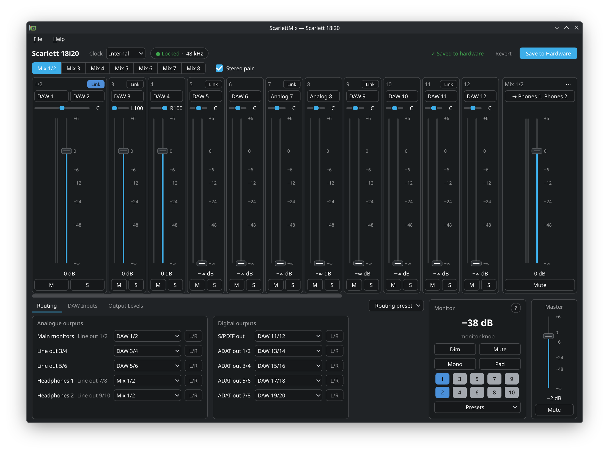

# ScarlettMix

Mixer and routing control for first-generation Focusrite Scarlett interfaces
on Linux, modelled on the discontinued Scarlett MixControl.

Developed and tested on a Scarlett 18i20 (USB `1235:800c`). The 6i6, 8i6,
18i6 and 18i8 use the same kernel driver and should work, but have not been
tried on hardware.

## Run

    python -m scarlettmix            # first supported Scarlett found
    python -m scarlettmix --demo     # simulated 18i20, touches no hardware
    python -m scarlettmix --status   # print the current setup and exit
    python -m scarlettmix --load my-setup.json   # apply a preset and exit
    python -m scarlettmix --save my-setup.json   # write the current setup to a preset

Requires Python 3.10+, PySide6 (`python-pyside6` on Arch) and `libasound`.
Your user needs access to the sound card, which a normal desktop login has.
No extra driver is needed: the kernel's `snd-usb-audio` already speaks the
interface's control protocol, and this program drives it through ALSA, so it
works while PipeWire or JACK is using the card.

To get a `scarlettmix` command, install the package (for example
`pipx install --system-site-packages .`); `scarlettmix.desktop` can then be
copied to `~/.local/share/applications/`. Installing is optional and untested
here; running from the checkout is what has been exercised.

## What it does

The window follows the original: mixer on top, routing below it, monitor
section at the right, with the original's names (DAW 1, Mix 1, Line Output 7).

- **Mixer**: eight mixes, each with a channel strip per mixer input
  (source, level, mute, solo) and a master. Adjacent mixes can be linked as
  a stereo mix with pan, and adjacent inputs as a stereo channel with
  balance. Faders use the original's taper. The master strip's send menu
  puts the mix on any output pair, including the two headphone outputs
  (Line 7/8 and 9/10 on the 18i20), and Copy Mix To duplicates a mix.
- **Routing**: source for every output in the original's grid, with the
  Clear, DAW Tracking, Zero Latency Tracking and Mixing presets, plus a tab
  for DAW capture channels.
- **Levels**: master in the monitor section, per-pair level and mute on a tab.
- **With the patched driver**: level meters beside the faders; File ▸ Save to
  Hardware; and the monitor section's Dim, Mute and ten output buttons:
  blue is in the monitor group (the knob, Mute and Dim control it), silver
  is independent, red is muted. Each click moves to the next state.
- **Saved or not** (with the patched driver): one rule for every control.
  Solid means saved to hardware. An outline (a hollow fader, an outlined
  button or drop-down) means changed and not saved: it is lost when the
  interface is switched off. A dot on a mix or tab says something inside is
  unsaved, and the top bar says "Saved to hardware" or "Not saved".
  **Revert** puts the interface back to its saved setup. Closing with
  unsaved changes asks: Save to Hardware, Discard (the interface goes back
  to its saved setup) or Cancel. Every Save to Hardware tells you to switch
  the interface off and on: its monitor knob only takes up its outputs when
  it starts. Until ScarlettMix has saved once it has nothing to compare
  with and draws everything solid.
- **After the interface restarts**, the driver cannot read levels and mixer
  gains back (the interface reports 0 dB until each is sent again). The
  app then shows your last saved setup and says so. **Read mixer** in that
  bar measures the gains the interface is really using with its own level
  meters: a quiet test tone on a free DAW channel, about 15 seconds, with
  the outputs that play mixes muted meanwhile and everything put back
  afterwards. Output levels cannot be measured this way (outputs have no
  meters).
- **The knob and newly blue outputs**: the interface only takes a new
  output onto its monitor knob when it powers on. Until then the program
  does that job while it is open: it reads the knob and sets the level of
  every blue output the interface is not moving itself, so blue always means
  "the knob controls it". When the program closes, such an output goes back
  to the level it had before, so its level differs with the program open
  and closed until the interface has been saved and switched off and on.
  Turning any output silver sets it to 0 dB, full level, as in the
  original (for headphones: the headphone knob alone then reaches the same
  maximum as both knobs together). Its fader on the Output Levels tab is greyed out
  ("monitor knob"). Apart from this the program changes nothing by itself.
  Mono, the monitor Pad and the original's Monitor Preset menu are there too.
- **Clock**: source selection, lock indicator, current sample rate.
- **Rate and Buffer**: PipeWire's sample rate and buffer size (with its
  latency), set from the header.
- **Presets**: save and load complete setups as JSON, and open original
  MixControl snapshot files (`.18i20` and friends).

Starting the program never changes the device: it reads what is there. If
another program (alsamixer, for example) changes something, the display
follows.

## Differences from the original

- Output levels move in 1 dB steps (the original is finer); that is what the
  kernel driver offers. Mixer levels are whole decibels in the original too.
- Level meters, save to hardware and the monitor section's output buttons
  need controls the stock kernel driver does not have. They appear when the
  patched driver in `../kernel` is loaded (`./load-test.sh`; a reboot or
  `./revert.sh` goes back to stock) and are absent otherwise. Details and
  measurements are in `docs/missing-features.md`.
- Sample rate and buffer size belong to PipeWire on Linux, not to the
  interface, so Rate and Buffer set PipeWire's clock (`clock.force-rate` and
  `clock.force-quantum`, as `pw-metadata -n settings 0` would). A change
  restarts the audio stream briefly and lasts until PipeWire restarts; while
  it would be lost it is drawn with an outline. Keep ▸ "Keep these" writes
  them as PipeWire's defaults to
  `~/.config/pipewire/pipewire.conf.d/90-scarlettmix-clock.conf`; the other
  Keep item, or deleting that file, undoes it from the next PipeWire start.
  None of this is part of Save to Hardware.

## Keeping settings across power cycles

The interface keeps its own settings: File ▸ Save to Hardware stores the
routing, mixer, output levels and monitor section in it, and it starts up
that way with or without a computer. (This needs the patched driver; the
stock one cannot send the save command.) Nothing runs in the background.

One limitation shapes how the program behaves afterwards. Once the interface
has powered on, the kernel driver reads its levels, mixer gains and mutes
back wrongly until each has been sent again. So ScarlettMix never treats
those readings as the truth:

- At every Save to Hardware it records the setup it saved
  (`~/.config/scarlettmix/saved-*.json`).
- After the interface or the computer restarts, it shows that recorded setup
  and a yellow bar saying so. Starting the program still sends nothing.
- **Sync** in that bar sends the shown setup, after which driver and
  interface agree and the bar goes away. Until then every change you make is
  sent regardless of what the driver believes.

Changes made after the last Save to Hardware are lost when the interface
loses power, as with the original.

Separately, the operating system saves the driver's readings at shutdown and
writes them back when a sound card appears (`alsactl restore`, from
`/usr/lib/udev/rules.d/90-alsa-restore.rules`). For this interface that can
replace what it restored from its own memory with stale values. To exempt
it, copy that file to `/etc/udev/rules.d/` and add, on the line after
`LABEL="alsa_restore_go"`:

    ATTRS{idVendor}=="1235", ATTRS{idProduct}=="800c", GOTO="alsa_restore_end"

## Layout

    scarlettmix/alsa.py      ctypes binding to the ALSA control API
    scarlettmix/backend.py   real card and simulated card
    scarlettmix/device.py    device structure discovered from control names
    scarlettmix/laws.py      fader and pan curves from the original
    scarlettmix/mixer.py     faders/pan/mute/solo/stereo -> hardware gain grid
    scarlettmix/presets.py   presets and MixControl snapshot import
    scarlettmix/monitor.py   monitor section: output buttons, knob, mono, pad
    scarlettmix/ui/          PySide6 interface
    docs/mixcontrol-protocol.md   how the original works, with evidence
    docs/missing-features.md      meters, save and monitor knob: protocol and plan
    driver/                       patched kernel driver: patch, build, load, revert

Tests: `python -m pytest`. They run against the simulated device only.

## License

GPL-3.0-or-later; see `LICENSE`. `driver/scarlett-gen1-extras.patch` is a
change to the Linux kernel and is GPL-2.0, like the kernel.

Not affiliated with Focusrite. "Scarlett" and "MixControl" are Focusrite's
names, used here only to say what this works with and what it replaces.
